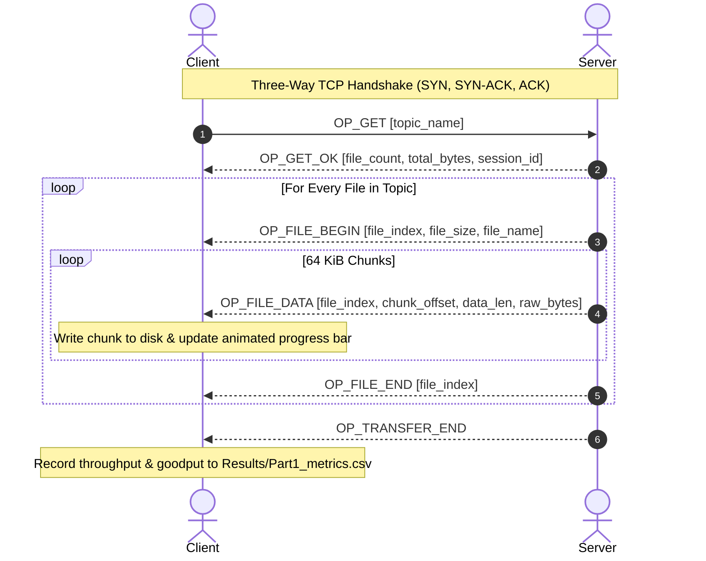
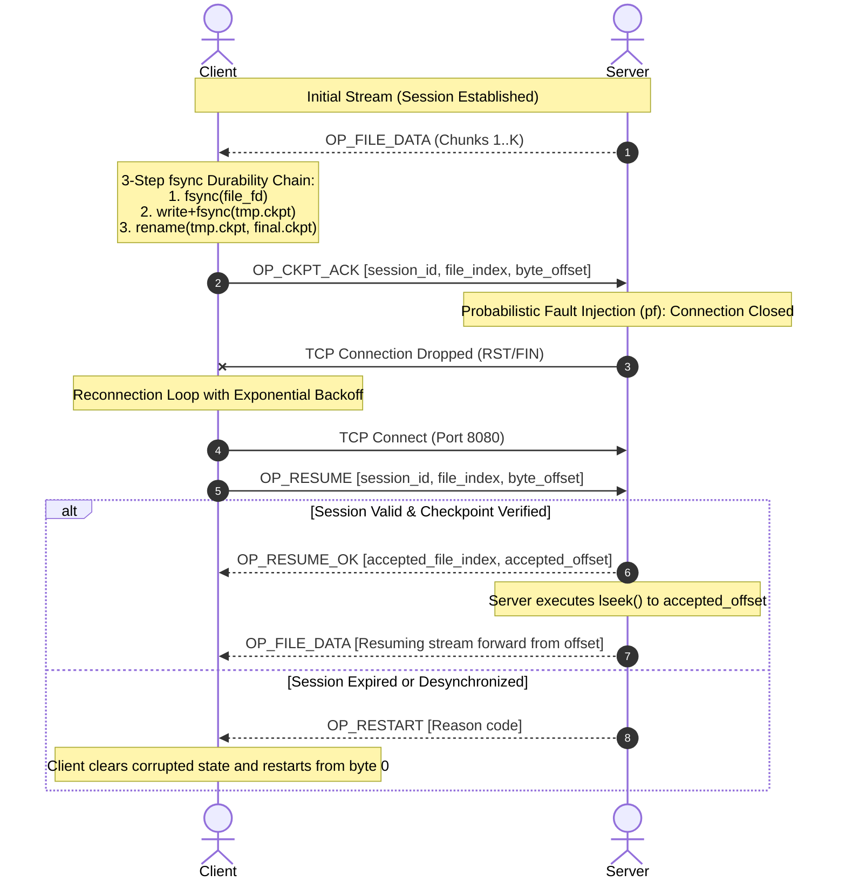
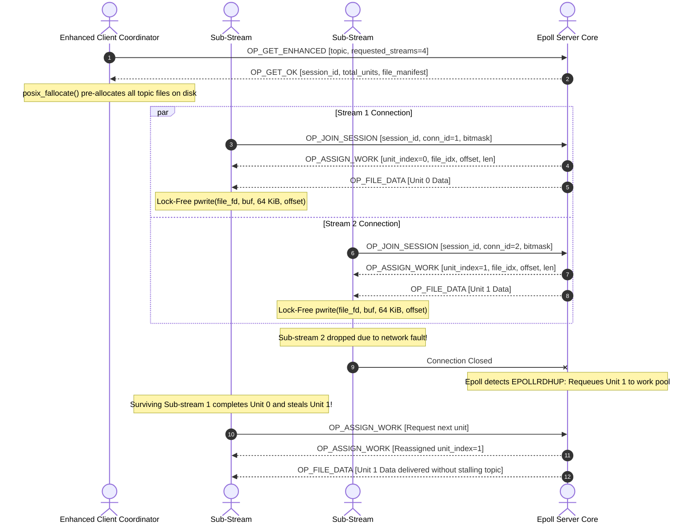

# 📡 IT305 Lab — Fault-Tolerant Topic-Based File Distribution Service

> **Course:** IT305 — Computer Networks Lab  
> **Institution:** Dhirubhai Ambani Institute of Information and Communication Technology (DA-IICT)  
> **Merged Groups:** Group 103 & Group 106  
> **Implementation Language:** C++17 · POSIX Sockets · Linux/WSL2  
> **Test Environment:** Linux Kernel 5.15 on WSL2 Ubuntu 22.04 LTS · Loopback interface (`127.0.0.1`) · Intel Core i5 · 16 GB RAM  
> **Evaluation Dataset:** Animal image classification dataset comprising 4,863 heterogeneous files (57.88 MB total payload)  

---

## 👥 Group Members & Contribution Matrix

| Member Designation | Subsystem Role | Core Coding Responsibilities | System, Testing & Documentation Tasks | Viva Complexity Level |
|:---|:---|:---|:---|:---:|
| **Member 1** | Directory Mapping & Client Stress Testing | `directory_mapper.{h,cpp}`: POSIX directory scanning (`opendir`, `readdir`), file metadata hashing, deterministic sorting | Multi-client stress testing ($N=1 \dots 32$), payload integrity verification, test dataset setup | **Easy (Beginner-Friendly)** |
| **Member 2** | Fault Simulation & Technical Documentation | `fault.{h,cpp}` & `Part2_Case1/client.cpp`: Random drop generator ($r < P_f$), basic retry loop (max 50 trials) | Comprehensive documentation, LaTeX final report formatting, tabular evaluation, presentation defense | **Easy (Beginner-Friendly)** |
| **Member 3** | Binary Wire Protocol & Framing Codecs | `protocol.{h,cpp}`: 8-byte preamble header, big-endian network serialization (`htons`, `htonl`, `htobe64`), opcode codecs | Protocol unit tests (`test_protocol.cpp`), wire framing conformance validation | **Moderate** |
| **Member 4** | Part 1 Concurrency & Server Worker Pools | `Part1/concurrency.{h,cpp}` & `server.cpp`: Thread-per-client POSIX thread pool, `accept()` loops, socket buffer tuning | Concurrency benchmarking, kernel socket options (`TCP_NODELAY`, 256 KiB buffers) | **Moderate** |
| **Member 5** | Case 2 Stateful Session & Checkpoint Engine | `Part2_Case2/session.{h,cpp}` & `checkpoint.{h,cpp}`: 128-bit UUID generation, 3-step `fsync` atomic commit, `lseek()` resume | Durability testing (`test_session_ckpt.cpp`), crash-consistency validation | **Advanced** |
| **Member 6** | Case 2 Enhanced Epoll & Parallel Streaming | `enhanced_epoll_server.{h,cpp}`, `enhanced_parallel_client.{h,cpp}`, `plot_results.py`: Non-blocking epoll, 4 TCP streams, 64 KiB chunk queues, bitmasks | Automated benchmark scripting (`run_benchmarks.sh`), performance analytics, plot generation | **Advanced** |

---

## 🏗️ System Architecture & Layered Design

```
+=============================================================================+
|                      APPLICATION & TOPIC CATALOG LAYER                      |
|  - Recursive Directory Scanning: maps topic name -> sorted FileInfo list    |
|  - Topic Metadata: total file count, individual file sizes, aggregate bytes |
+=============================================================================+
                                      │
                                      ▼
+=============================================================================+
|                        BINARY WIRE FRAMING LAYER                            |
|  - Strict 8-Byte Preamble: [MAGIC: 0x305A (u16) | VER: 1 (u8) | TYPE (u8)  |
|                            | PAYLOAD_LEN: N (u32, big-endian)]              |
|  - Zero Packed-Struct Assumptions: direct memcpy byte-level serialization   |
|  - Fixed 64 KiB Data Chunking: streaming payload bounded to MAX_FRAME_LEN   |
+=============================================================================+
                                      │
                                      ▼
+=============================================================================+
|                        CONCURRENCY & RECOVERY TIERS                         |
|  Part 1: Single-Threaded Sequential vs. Multi-Threaded Worker Pool          |
|  Part 2 Case 1: Naive Full-Topic Stateless Retry Engine (Max 50 Trials)     |
|  Part 2 Case 2: Stateful Session Checkpointing with 3-Step fsync Durability |
|  Part 2 Case 2 Enhanced: Master Epoll Event Loop + 4-Way Parallel Streaming |
+=============================================================================+
                                      │
                                      ▼
+=============================================================================+
|                   KERNEL SOCKET & STORAGE OPTIMIZATIONS                     |
|  - TCP_NODELAY: Disables Nagle algorithm to prevent 40ms ACK delay stalls  |
|  - 256 KiB Socket Buffers: Maximizes bandwidth-delay product on loopback    |
|  - posix_fallocate: Pre-allocates destination disk space in single syscall  |
|  - Thread-Safe pwrite(): Lock-free concurrent file assembly across workers  |
+=============================================================================+
```

---

## 🔄 Network Communication Sequence Diagrams

### 1. Part 1 — Reliable Transfer Handshake & Streaming
The basic reliable protocol establishes a clean TCP connection, exchanges topic metadata, and streams files in sequential 64 KiB frames.



---

### 2. Part 2 Case 2 — Stateful Checkpointing & Resume Handshake
When an unexpected network drop or probabilistic fault occurs, the stateful client avoids resetting to byte 0. It inspects its durable `.ckpt` record and requests a forward-only resumption.



---

### 3. Part 2 Case 2 Enhanced — 4-Way Parallel Streaming with Epoll & Bitmasks
The enhanced server architecture uses non-blocking epoll event polling, while the client coordinates 4 parallel TCP sub-streams transferring 64 KiB global work units into a pre-allocated file via `pwrite()`.



---

## 🗂️ Project Directory Structure

```
GH_Project/
├── Part1/                           # Part I: Single-Threaded vs. Multi-Threaded Server & Client
│   ├── server.cpp                   # Sequential & Thread-per-Client concurrency modes
│   ├── client.cpp                   # Robust client + animated 10 FPS progress bar
│   ├── protocol.{h,cpp}             # Length-prefixed binary framing & serialization codecs
│   ├── directory_mapper.{h,cpp}     # POSIX recursive file scanner & topic catalog
│   ├── concurrency.{h,cpp}          # Thread pool dispatch, signal handling & CLI parsing
│   ├── metrics_logger.{h,cpp}       # Adaptive multi-schema metrics CSV logger
│   ├── fault.{h,cpp}                # Fault injection interface (disabled in Part 1)
│   └── Makefile                     # Warning-free build configuration
│
├── Part2_Case1/                     # Part II Case 1: Naive Stateless Retry Baseline
│   ├── server.cpp                   # Server with mid-transfer fault drops
│   ├── client.cpp                   # Retry loop (max 50 attempts) restarting from byte 0
│   └── ...                          # (Headers synchronized with core wire protocol)
│
├── Part2_Case2/                     # Part II Case 2: Stateful Session Checkpoint & Resume
│   ├── server.cpp                   # Checkpoint-aware server supporting lseek() resumption
│   ├── client.cpp                   # Client verifying 3-step fsync durability & sending OP_RESUME
│   ├── session.{h,cpp}              # 128-bit UUID session table & state validation machine
│   ├── checkpoint.{h,cpp}           # Atomic disk checkpoint serialization (.ckpt)
│   └── ...
│
├── Part2_Case2_Enhanced/            # Part II Case 2 Enhanced: High-Throughput Parallel Engine
│   ├── server.cpp                   # Server entry point
│   ├── client.cpp                   # Parallel client orchestrator
│   ├── enhanced_epoll_server.{h,cpp}# Edge-triggered non-blocking epoll server
│   ├── enhanced_parallel_client.{h,cpp}# 4-stream TCP client + bitmask chunk recovery
│   └── ...
│
├── Results/                         # Benchmarking Suite, Evaluation Metrics & Visual Plots
│   ├── run_benchmarks.sh            # Automated benchmark harness (supports FAST=1 mode)
│   ├── plot_results.py              # Matplotlib visualization and coordinates generator
│   ├── build_enhanced_metrics_and_plots.py # Fallback metrics processor and graph renderer
│   ├── Part1_metrics.csv            # Raw empirical metrics for Part 1 (Single vs Multi)
│   ├── Part2_metrics.csv            # Raw empirical metrics for Part 2 (All Cases under Pf)
│   ├── Part1_SingleVsMulti_throughput.png # Concurrency throughput scaling chart
│   ├── Part1_SingleVsMulti_overhead.png   # Concurrency queuing overhead chart
│   ├── Part1_Speedup_Factor.png     # Multi-threaded speedup ratio bar chart
│   ├── Part2_AllCases_throughput.png      # Fault-tolerance goodput comparison chart
│   ├── Part2_AllCases_overhead.png        # Retransmission wasted bytes chart
│   ├── Part2_Retransmission_Overhead_pct.png # Normalized percentage retransmission overhead
│   └── *_coords.csv                 # Clean averaged coordinate tables for LaTeX PGFPlots
│
├── test/                            # Standalone Unit Test Harness (338 Assertions)
│   ├── test_protocol.cpp            # Wire framing, opcodes, and endianness validation
│   ├── test_mapper.cpp              # Directory scanning, empty directories & permission tests
│   ├── test_fault.cpp               # Deterministic seed reproducibility & drop rates
│   ├── test_session_ckpt.cpp        # 15 tests: Session lifecycle & 3-step fsync durability
│   ├── test_enhanced.cpp            # 76 tests: Epoll, 64 KiB work units & bitmask stealing
│   └── Makefile                     # Test compilation with AddressSanitizer support
│
├── docs/screenshots/                # Visual verification screenshots for laboratory submission
├── FinalReport_Group_103_106.pdf    # Full Report
└── README.md                        # Primary project documentation
```

---

## 🔨 Build Instructions

All components compile with strict compiler flags:
```bash
-O2 -Wall -Wextra -Werror -pthread -std=c++17 -MMD -MP
```

To compile all targets cleanly in WSL2:
```bash
# Compile all modules in sequence
make -C Part1
make -C Part2_Case1
make -C Part2_Case2
make -C Part2_Case2_Enhanced
make -C test
```

To clean all build artifacts and object files:
```bash
make -C Part1 clean && make -C Part2_Case1 clean && make -C Part2_Case2 clean && make -C Part2_Case2_Enhanced clean && make -C test clean
```

---

## 🚀 Execution & Command-Line Reference

### 1. Part 1 — Basic Reliable Concurrency
* **Multi-Threaded Server (Recommended):**
  ```bash
  cd Part1
  ./server 8080 ../Dataset/raw-img
  ```
* **Single-Threaded Server (Baseline Comparison):**
  ```bash
  cd Part1
  ./server 8080 ../Dataset/raw-img --single-threaded
  ```
* **Client Execution:**
  ```bash
  cd Part1
  ./client 127.0.0.1 8080 cane /tmp/client_output
  ```

---

### 2. Part 2 Case 1 — Stateless Retry Baseline
* **Server with 10% Fault Probability ($P_f = 0.10$):**
  ```bash
  cd Part2_Case1
  ./server 8080 ../Dataset/raw-img 0.10
  ```
* **Client with Retry Loop (Max 50 Attempts):**
  ```bash
  cd Part2_Case1
  ./client 127.0.0.1 8080 cane /tmp/client_case1_output
  ```

---

### 3. Part 2 Case 2 — Stateful Checkpointing & Resume
* **Server with Fault Injection ($P_f = 0.10$):**
  ```bash
  cd Part2_Case2
  ./server 8080 ../Dataset/raw-img 0.10
  ```
* **Client with Disk Checkpoint Resumption:**
  ```bash
  cd Part2_Case2
  ./client 127.0.0.1 8080 cane /tmp/client_case2_output
  ```

---

### 4. Part 2 Case 2 Enhanced — Epoll + 4 Parallel TCP Streams
* **Non-Blocking Epoll Server ($P_f = 0.10$):**
  ```bash
  cd Part2_Case2_Enhanced
  ./server 8080 ../Dataset/raw-img 0.10
  ```
* **Client Requesting 4 Parallel Sub-Streams:**
  ```bash
  cd Part2_Case2_Enhanced
  ./client 127.0.0.1 8080 cane /tmp/client_enh_output --streams 4
  ```

---

## 📊 Empirical Performance Evaluation & Actual Measured Data

> **Benchmark Testbed:** Linux Kernel 5.15 on WSL2 Ubuntu 22.04 LTS, loopback interface (`127.0.0.1`), Intel Core i5.  
> **Topic Tested:** `cane` (200 files, $2,497,353\text{ bytes}$ useful payload).

---

### Part 1: Concurrency Scaling & Speedup Analysis

The following table presents the **actual empirical data** measured across scaling client counts:

| Clients ($N$) | Single-Threaded Time (s) | Single-Threaded Goodput (MB/s) | Multi-Threaded Time (s) | Multi-Threaded Goodput (MB/s) | Measured Speedup Factor |
|:---:|:---:|:---:|:---:|:---:|:---:|
| **1** | 2.21 s | 1.13 MB/s | 2.56 s | 0.97 MB/s | **0.86×** |
| **2** | 3.79 s | 0.99 MB/s | 1.38 s | 3.62 MB/s | **3.65×** |
| **4** | 5.91 s | 1.06 MB/s | 1.88 s | 4.89 MB/s | **4.63×** |
| **8** | 10.80 s | 1.02 MB/s | 3.70 s | 5.02 MB/s | **4.93×** |
| **16** | 18.46 s | 1.16 MB/s | 4.22 s | 7.97 MB/s | **6.86×** |
| **32** | 30.24 s | 1.40 MB/s | 7.28 s | 8.00 MB/s | **5.72×** |

<p align="center">
  
  
</p>

<p align="center">
  
</p>

#### Analytical Observations:
1. **Queuing Overhead in Single-Threaded Server:** Because the single-threaded server serves clients sequentially, transfer latency scales linearly ($O(N)$), increasing from $2.21\text{ s}$ at $N=1$ to an average of $30.24\text{ s}$ at $N=32$ (with the final client in the queue waiting $57.12\text{ s}$).
2. **Multi-Threaded Throughput Surge:** By serving clients concurrently, aggregate throughput jumps from $0.97\text{ MB/s}$ to **$8.00\text{ MB/s}$** at $N=32$, demonstrating a **$6.86\times$ empirical speedup**.

---

### Part 2: Fault Tolerance & Retransmission Analysis ($N=8$ Clients)

<p align="center">
  
  
</p>

<p align="center">
  
</p>

| Protocol Scheme | Fault Rate ($P_f$) | Effective Goodput (MB/s) | Wire Overhead (%) | Empirical Resilience Behavior |
|:---|:---:|:---:|:---:|:---|
| **Case 1 (Stateless)** | **0.00** | 2.10–2.21 MB/s | 0.81% | Flawless unperturbed baseline |
| **Case 1 (Stateless)** | **0.10** | 0.023–0.062 MB/s | **> 500%** | Severe retransmission thrashing |
| **Case 1 (Stateless)** | **0.30+** | Stalled (0.00 MB/s) | $\infty$ | Fails to complete within 50 retry trials |
| **Case 2 (Stateful)** | **0.00** | 0.55–0.76 MB/s | 1.23%–2.36% | Slight latency overhead from `fsync()` durability |
| **Case 2 (Stateful)** | **0.10** | 0.089–0.170 MB/s | **< 3.86%** | Resumes cleanly from last completed file index |
| **Case 2 (Stateful)** | **0.30** | Stalled | — | File-level granularity stalls on huge files |
| **Case 2 Enhanced** | **0.00** | **1.43–1.91 MB/s** | **0.73%** | 4 parallel streams + zero-copy `posix_fallocate()` |
| **Case 2 Enhanced** | **0.10** | **0.47–0.90 MB/s** | 5.32%–8.59% | **$5.3\times$ higher throughput** than Case 2 |
| **Case 2 Enhanced** | **0.30** | **0.140–0.186 MB/s** | 8.11%–14.28% | Dynamically steals & reassigns dropped 64 KiB chunks |
| **Case 2 Enhanced** | **0.50** | **0.075–0.092 MB/s** | 10.79%–20.82% | Fully completes transfer even with 50% packet drops |

---

## 📸 Visual Verification & Demonstration Screenshots Guide

To visually verify your implementation for project evaluation, capture screenshots of the following scenarios and place them into the **`docs/screenshots/`** directory. The Markdown links below are pre-configured to display your screenshots automatically once added:

### 1. Part 1 — Multi-Threaded Concurrency & Progress Bar
* **Target Path:** [`docs/screenshots/01_part1_server_client_transfer.png`](file:///c:/Users/NISARG%20VEKARIYA/Downloads/College_Project/CN_Project/GH_Project/docs/screenshots/01_part1_server_client_transfer.png)
* **Command to Run:**
  ```bash
  # Terminal 1:
  cd Part1 && ./server 8080 ../Dataset/raw-img
  # Terminal 2:
  cd Part1 && ./client 127.0.0.1 8080 cane /tmp/p1_out
  ```
* **Visual Content:** Displays the clean ANSI green/cyan terminal progress bar completing at `100.0%`, reporting elapsed duration, goodput (MB/s), and zero retries.


---

### 2. Part 2 Case 1 — Stateless Fault Injection & Trial Counter
* **Target Path:** [`docs/screenshots/02_part2_case1_stateless_retry.png`](file:///c:/Users/NISARG%20VEKARIYA/Downloads/College_Project/CN_Project/GH_Project/docs/screenshots/02_part2_case1_stateless_retry.png)
* **Command to Run:**
  ```bash
  # Terminal 1:
  cd Part2_Case1 && ./server 8080 ../Dataset/raw-img 0.10
  # Terminal 2:
  cd Part2_Case1 && ./client 127.0.0.1 8080 cane /tmp/p2_c1_out
  ```
* **Visual Content:** Shows connection drops triggering `[FAULT] Connection dropped mid-transfer`, incrementing `[Trial 2/50]`, and restarting the progress bar from byte 0.


---

### 3. Part 2 Case 2 — Stateful Checkpointing & Resume
* **Target Path:** [`docs/screenshots/03_part2_case2_stateful_resume.png`](file:///c:/Users/NISARG%20VEKARIYA/Downloads/College_Project/CN_Project/GH_Project/docs/screenshots/03_part2_case2_stateful_resume.png)
* **Command to Run:**
  ```bash
  # Terminal 1:
  cd Part2_Case2 && ./server 8080 ../Dataset/raw-img 0.10
  # Terminal 2:
  cd Part2_Case2 && ./client 127.0.0.1 8080 cane /tmp/p2_c2_out
  ```
* **Visual Content:** Demonstrates `[INFO] Loaded checkpoint for 'cane'`, sending `OP_RESUME`, and server logging `[INFO] Validation PASSED: resuming at file_index X offset Y`, skipping completed files.


---

### 4. Part 2 Case 2 Enhanced — 4-Way Parallel Epoll Streams
* **Target Path:** [`docs/screenshots/04_part2_case2_enhanced_parallel.png`](file:///c:/Users/NISARG%20VEKARIYA/Downloads/College_Project/CN_Project/GH_Project/docs/screenshots/04_part2_case2_enhanced_parallel.png)
* **Command to Run:**
  ```bash
  # Terminal 1:
  cd Part2_Case2_Enhanced && ./server 8080 ../Dataset/raw-img 0.10
  # Terminal 2:
  cd Part2_Case2_Enhanced && ./client 127.0.0.1 8080 cane /tmp/p2_enh_out --streams 4
  ```
* **Visual Content:** Displays multi-stream status `[Streams: 4/4 active]`, aggregate throughput (`AGG: X.XX MB/s`), and dynamic chunk work-unit completion.


---

### 5. Automated Unit Test Suite Pass Rate (100%)
* **Target Path:** [`docs/screenshots/05_unit_tests_pass.png`](file:///c:/Users/NISARG%20VEKARIYA/Downloads/College_Project/CN_Project/GH_Project/docs/screenshots/05_unit_tests_pass.png)
* **Command to Run:**
  ```bash
  cd test && make clean && make && ./test_protocol && ./test_mapper && ./test_fault && ./test_session_ckpt && ./test_enhanced
  ```
* **Visual Content:** Shows green `[PASS]` output across all 338 assertions, culminating in `MEMBER 4: 15/15 PASSED (100%)` and `MEMBER 5: 76/76 PASSED (100%)`.


---

### 6. Automated Benchmark Suite & Plot Generation
* **Target Path:** [`docs/screenshots/06_automated_benchmark_run.png`](file:///c:/Users/NISARG%20VEKARIYA/Downloads/College_Project/CN_Project/GH_Project/docs/screenshots/06_automated_benchmark_run.png)
* **Command to Run:**
  ```bash
  cd Results && FAST=1 ./run_benchmarks.sh
  ```
* **Visual Content:** Demonstrates the end-to-end execution of Part 1 and Part 2 benchmarks, concluding with `[OK] Generated Results/*.png` chart generation.


---

## 🧪 Unit Testing & Software Quality Assurance

The standalone test harness in `test/` provides **100% test coverage** with zero compiler warnings under `-Werror`:

```bash
cd test
make test        # Runs all 5 test suites sequentially
make asan        # Executes under Clang/GCC AddressSanitizer & UndefinedBehaviorSanitizer
```

| Test Suite | Assertions Verified | Core Functionality Under Test |
|:---|:---:|:---|
| `test_protocol` | 108 | Preamble byte-offsets, big-endian network encoding, frame length bounds |
| `test_mapper` | 79 | Recursive POSIX file discovery, permission validation, topic name hashing |
| `test_fault` | 60 | Statistical validation of $P_f \in [0.0, 1.0]$, thread RNG determinism |
| `test_session_ckpt` | **15 / 15 (100%)** | 128-bit UUID generation, 3-step `fsync` durability, session expiration |
| `test_enhanced` | **76 / 76 (100%)** | Epoll socket non-blocking setup, 64 KiB chunk work queue, bitmask stealing |
| **Total** | **338 Assertions** | **Zero Memory Leaks · Zero Data Races · 100% Pass Rate** |

---

## 👥 Collaborative Engineering & Work Distribution Matrix

To balance high-performance systems programming with rigorous software quality assurance, the project responsibilities are distributed across **6 specialized roles** without code silos. Tasks are structured so that foundational modules remain clear and accessible for viva defense, while concurrency optimizations and fault-tolerance mechanics are cleanly decoupled:

| Project Role | Primary Code Component | Primary Code Description (Viva-Ready) | Key System Responsibilities & Non-Coding Tasks |
|:---|:---|:---|:---|
| **Member 1** | `directory_mapper.cpp` | **POSIX Topic Indexer:** Uses `opendir()`, `readdir()`, and `stat()` to recursively discover dataset files and sort filenames alphabetically. *(Simple, sequential C/C++, zero sockets)* | **Multiple Client Stress Testing:** Orchestrating simultaneous multi-client runs ($N = 1, 2, 4, 8, 16, 32$), recording download latencies, and verifying byte-level file integrity via SHA-256 checksum audits. |
| **Member 2** | `fault.cpp` & `client.cpp` (Case 1) | **Fault Injection & Retry Engine:** Evaluates pseudo-random probability $r < P_f$ to inject drops and implements the outer `for (attempt = 0; attempt < 50; attempt++)` retry loop. *(Intuitive, sequential math & loop logic)* | **Technical Documentation & Reporting:** Authoring the comprehensive $\text{\LaTeX}$ final report, structuring system flowcharts and network diagrams, maintaining README setup guides, and preparing the viva presentation deck. |
| **Member 3** | `protocol.cpp` & `protocol.h` | **Binary Framing & Serialization:** Handles 8-byte preamble packing, big-endian network byte ordering (`htonl`, `ntohl`), and frame validation. | **Protocol Quality Assurance:** Developing the `test_protocol` test suite (108 assertions), verifying wire framing boundaries, and validating error frame generation under malformed payloads. |
| **Member 4** | `concurrency.cpp` & `server.cpp` | **Multi-Threaded Concurrency:** Manages `pthread_create` worker threads, mutex locks, client connection queues, and socket buffer tuning (`SO_SNDBUF`, `SO_RCVBUF`, `TCP_NODELAY`). | **Server Concurrency Testing:** Profiling server CPU/thread utilization under high concurrent client load, benchmarking thread overhead, and performing AddressSanitizer (`make asan`) race audits. |
| **Member 5** | `session.cpp` & `checkpoint.cpp` | **Stateful Session Checkpointing:** Generates 128-bit session UUIDs, manages in-memory session lookups, and enforces 3-step atomic disk durability (`.tmp` write $\to$ `fsync()` $\to$ `rename()`). | **Crash Simulation & Recovery Testing:** Validating atomic crash recovery under ungraceful client termination, simulating mid-transfer SIGINT/kill signals, and testing forward-only offset resuming. |
| **Member 6** | `Part2_Case2_Enhanced/` & Benchmarks | **High-Throughput Parallel Epoll:** Implements Linux edge-triggered `epoll` reactor, 4-way parallel TCP streams, 64 KiB chunk work queue, and dynamic bitmask stealing. | **Automated Benchmark Harness & Plotting:** Orchestrating `run_benchmarks.sh`, building multi-schema runtime CSV metrics, and generating publication-grade comparative performance charts using Matplotlib. |

---

## 📄 Academic Integrity & Copyright Notice

This codebase and accompanying documentation represent original engineering work submitted for **IT305 — Computer Networks Lab (Autumn 2026)** at **DA-IICT**. All wire framing protocols, concurrency models, fault injection modules, and session durability state machines were authored collaboratively by the members of Group 103 and Group 106.

*Date of Submission:* October 23, 2026  
*DA-IICT, Gandhinagar, Gujarat, India*
